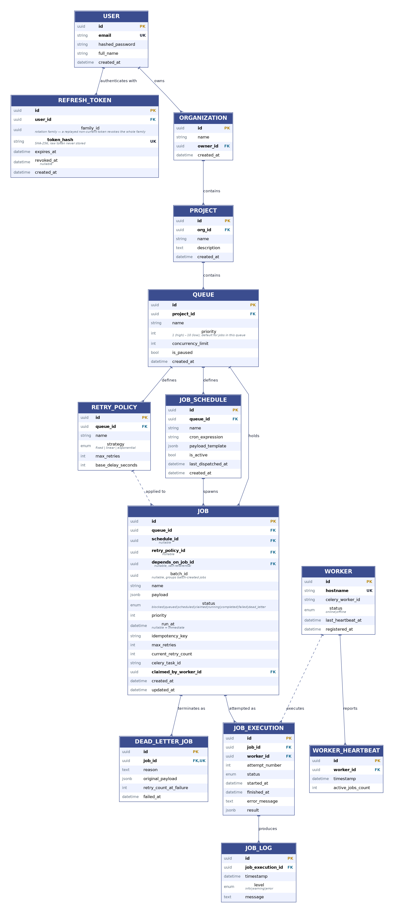

# Pulse — Entity Relationship Diagram

This document focuses on the important keys and relationships so the diagram remains readable on GitHub. For exact column definitions and constraints, `backend/app/models.py` and the Alembic migrations are authoritative.

## Current database model



*20 entities across auth, tenancy, RBAC, audit logging, webhooks, scheduling, DAG workflows, and execution. The self-referential `Job.depends_on_job_id` relationship and `JobDependency` join table are omitted from the rendered image for visual clarity — see [DAG Dependencies](#directed-acyclic-graph-dag-dependencies) below.*

## How the model is organized

### Tenancy and access hierarchy

```text
User ──── owns ────> Organization ──> Project ──> Queue
  │                        ▲
  └──── member of ─────────┘ (via OrganizationMember: admin | member)

Organization ── owns ──> InviteToken (single-use hashed token for employee onboarding)
Organization ── owns ──> AuditLog (immutable trail of operator actions and mutations)
Organization ── owns ──> WebhookSubscription (outbound push event configurations)
```

Tenant-owned API resources follow this chain. Access is governed by the `OrganizationMember` authority table:
- **`system_admin`** (platform operator): manages all organizations and users.
- **`org_admin`** (organization admin): owns the org, invites members, manages projects and queues.
- **`member`** (team member): submits, views, and explores jobs within the organization.

### Audit logging

```text
AuditLog
 ├── user_id (nullable actor reference)
 ├── org_id (tenant boundary)
 ├── action & resource_type
 └── details (JSONB metadata)
```

Sensitive operator mutations (queue pause/resume, queue configuration edits, job retries, member invitations and removals, user role changes, schedule toggling) write an immutable record to `audit_logs`.


### Job state and execution history

```text
Job
 ├── JobExecution × N
 │     └── JobLog × N
 └── DeadLetterJob (0..1 current record)
```

`Job` stores current state. `JobExecution` records attempts. `JobLog` records attempt-level messages. `DeadLetterJob` represents the job's current terminal DLQ state rather than a second execution history.

### Directed Acyclic Graph (DAG) dependencies

Workflows support arbitrary Directed Acyclic Graphs (DAGs) with multi-parent fan-in (`A, B → C`), multi-child fan-out (`C → D, E`), and diamond topologies (`A → B, C → D`).

```text
       ┌───────────┐
       │   Job A   │
       └─────┬─────┘
             │ (Fan-Out)
       ┌─────┴─────┐
       ▼           ▼
  ┌─────────┐ ┌─────────┐
  │  Job B  │ │  Job C  │
  └────┬────┘ └────┬────┘
       │ (Fan-In)  │
       └─────┬─────┘
             ▼
       ┌───────────┐
       │   Job D   │ (Waits for BOTH B & C)
       └───────────┘
```

Dependencies are normalized via the `JobDependency` (`job_dependencies`) join table:
- **Composite Primary Key**: `(parent_job_id, child_job_id)` enforces edge uniqueness.
- **Foreign Key Cascades**: Both `parent_job_id` and `child_job_id` reference `jobs.id` with `ON DELETE CASCADE`.
- **Topological Integrity**: In-memory Depth-First Search (`detect_cycle_dfs`) guarantees acyclic topology before dependency rows are committed.
- **Backward Compatibility**: Single-parent `Job.depends_on_job_id` is preserved as an auto-synchronized convenience pointer.

### Retry policies

A Queue can own multiple retry policies and a Job can optionally reference one through `retry_policy_id`. In the current execution path, the selected policy supplies the retry strategy/base delay while `Job.max_retries` controls retry exhaustion.

### Workers

Workers are shared execution infrastructure. A worker can execute many attempts, report heartbeats, and temporarily appear as the current claimant of jobs. Historical execution records remain if a worker is removed; worker foreign keys use `SET NULL` where appropriate.

### Webhooks and delivery history

```text
Organization ── owns ──> WebhookSubscription × N
                             │
                             └── owns ──> WebhookDelivery × N
```

- **`WebhookSubscription`**: Scoped to an `organization_id`. Stores the destination `url`, cryptographic HMAC signing `secret` (`whsec_...`), subscribed `events` array (e.g. `["*"]` or `["job.completed", "job.failed"]`), `is_active` boolean, and optional description.
- **`WebhookDelivery`**: Audit log of each outbound dispatch attempt linked to `subscription_id` with `event`, request `payload`, HTTP `status_code`, truncated `response_body` (capped at 2KB), `error_message`, execution `duration_ms`, `attempt_number`, and `is_success`. Cascades on subscription deletion.

## Important constraints

- `users.email` is unique.
- `(org_id, user_id)` is unique in `organization_members`.
- `invite_tokens.token_hash` is unique.
- Project names are unique within an organization.
- Queue names are unique within a project.
- Worker hostnames are unique.
- Refresh-token hashes are unique.
- A Job has at most one current `DeadLetterJob` row.
- Job submission idempotency is scoped by `(queue_id, idempotency_key)`.
- `(queue_id, status)` is indexed for queue/job filtering.
- Celery task IDs and other operational lookup fields are indexed.
- `webhook_subscriptions.org_id` is foreign-keyed to `organizations.id` with `CASCADE`.
- `webhook_deliveries.subscription_id` is foreign-keyed to `webhook_subscriptions.id` with `CASCADE`.
- `(webhook_deliveries.subscription_id, delivered_at)` is indexed for fast delivery history queries.
- `(parent_job_id, child_job_id)` is the composite primary key in `job_dependencies`.
- `job_dependencies.parent_job_id` and `job_dependencies.child_job_id` are foreign-keyed to `jobs.id` with `CASCADE`.
- `job_dependencies.child_job_id` and `job_dependencies.parent_job_id` are individually indexed for fast prerequisite resolution and recursive cascading failure traversal.

---


## Updating the diagram

When the database changes, update this diagram **after** updating `backend/app/models.py` and the corresponding Alembic migration. The code and migration history remain the source of truth.
